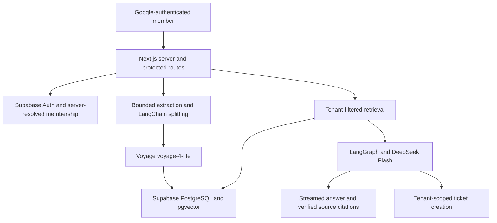

# Resolvo

A private, multi-tenant company knowledge workspace. Sign in with Google, create a company, connect real sources, and ask an assistant that retrieves and cites only that company's indexed knowledge.

## Run

Node.js 22.16+ and npm are required.

```powershell
npm ci
# Configure .env.local using .env.example. Never overwrite existing credentials.
npm run dev
```

Open [Resolvo](http://localhost:3000). There is no unauthenticated chat, sample workspace, seed data, or fallback response provider.

## Supabase and Google

1. Apply every unapplied file in `supabase/migrations/` in filename order, using Supabase's SQL Editor or a linked `supabase db push`. Do not rerun applied migrations. An installation with tenant workspaces already enabled needs only [the resumable indexing migration](supabase/migrations/202610090001_resumable_indexing.sql); it preserves all existing documents and vectors.
2. Enable Google in Supabase Auth and configure its OAuth client ID and secret. In Google's console, authorize the callback URL displayed by Supabase. Keep the Google client secret in Supabase, never in the application or browser.
3. Set the Supabase Auth Site URL to the application's origin. Allow `http://localhost:3000/auth/callback` for local development and the exact HTTPS production callback for Vercel. Avoid broad wildcard production redirect allowlists.
4. Add the settings below to local and Vercel environments. Restart the application after changing them.
5. Sign in with Google. An account without a workspace is redirected to onboarding, where workspace creation and owner membership happen in one transaction.

| Setting | Purpose |
| --- | --- |
| `SUPABASE_URL` | Supabase project URL |
| `SUPABASE_PUBLISHABLE_KEY` | Publishable or legacy anon key for authenticated SSR clients |
| `APP_URL` | Exact application origin, such as `http://localhost:3000`; HTTPS in production |
| `DEEPSEEK_API_KEY` | DeepSeek Flash generation and tool calling |
| `VOYAGE_API_KEY` | Voyage document and query embeddings |
| `SUPABASE_SERVICE_ROLE_KEY` | Server-only credential for the shared Voyage rate-budget RPCs and setup inspection; document operations use user JWTs and RLS |
| `VOYAGE_REQUESTS_PER_MINUTE` | Shared Voyage RPM budget; defaults to `3` for the trial account |
| `VOYAGE_TOKENS_PER_MINUTE` | Shared Voyage TPM budget; defaults to `10000` for the trial account |

All settings are read on the server. The publishable key is not a privileged secret, but the server-started PKCE flow keeps it out of the browser bundle as well. DeepSeek, Voyage, and service-role credentials never reach client components. A service-role key is explicitly rejected as an authentication key.

[Google provider setup](https://supabase.com/docs/guides/auth/social-login/auth-google), [Supabase SSR](https://supabase.com/docs/guides/auth/server-side/creating-a-client).

### Google OAuth callbacks and `redirect_uri_mismatch`

There are two different callbacks in this server-side PKCE flow:

| Configuration | Required value for the current local setup |
| --- | --- |
| Google Cloud → Google Auth Platform → Clients → Web application → **Authorized redirect URIs** | `https://eobqdatsbwniqtvbusux.supabase.co/auth/v1/callback` |
| Supabase → Authentication → URL Configuration → **Site URL** | `http://localhost:3000` |
| Supabase → Authentication → URL Configuration → **Redirect URLs** | `http://localhost:3000/auth/callback` |
| `.env.local` → **APP_URL** | `http://localhost:3000` |

Google returns its provider authorization code to Supabase's `/auth/v1/callback`. Supabase then redirects to Resolvo's `/auth/callback`, where the server exchanges the application code using the HttpOnly PKCE verifier cookie and verifies the user before redirecting to the dashboard. Google rejects an unregistered provider callback before Resolvo's callback executes. A `303` from `/auth/google` is the expected handoff, and a `302` from Supabase alone does not prove Google accepted the request.

Run `npm run verify:oauth` to print the **actual** Google client ID and callback sent by the configured Supabase project. In [Google Cloud Clients](https://console.cloud.google.com/auth/clients), select that exact OAuth client, add the callback above under **Authorized redirect URIs**, and save. The URI must match its scheme, host, path and trailing slash exactly; the value above has no trailing slash. In Supabase → Authentication → Sign In / Providers → Google, confirm that the client ID and client secret belong to this same **Web application** client. Keep the secret in Supabase. Editing a different Google client will not fix the active request.

The probe follows Google's public authorization redirects and detects OAuth error pages even when Google responds with HTTP 200. It uses a fresh, isolated PKCE request, does not sign in a user, exchanges no authorization code, and prints no keys, cookies or OAuth state. A successful probe means Google reached its interactive sign-in page; complete consent, sign-in and sign-out in the browser to verify the full session. `npm run verify:setup` separately checks the database/workspace configuration.

For production, set Vercel → Project → Settings → Environment Variables → `APP_URL` to the deployed HTTPS origin, and redeploy. Set Supabase's **Site URL** to that origin and add that origin plus `/auth/callback` to **Redirect URLs** while retaining the local callback if local development is still needed. The Google **Authorized redirect URI** stays the same when local and production use this same Supabase project. If production uses a different Supabase project or Auth custom domain, run the probe against its environment and register the callback it reports in the matching Google client. Do not invent a production hostname or use broad wildcard callbacks.

[Google redirect matching rules](https://developers.google.com/identity/protocols/oauth2/web-server#redirect-uri-mismatch), [Supabase application redirect URLs](https://supabase.com/docs/guides/auth/redirect-urls).

### Existing data

The tenant migration preserves existing unowned documents, vectors, tickets and conversations under an archived organization with no members. Historical order records and ticket/order associations move to the unexposed `private` schema. Existing files are not moved or deleted and cannot be accessed through the new workspace policies. New companies start empty; historical records are never assigned automatically to whoever signs in first. An operator can export legacy files through trusted Supabase administration and import the appropriate real knowledge into its verified owner's new workspace.

The original migrations remain unchanged as applied history. Sample data, order lookups, industry-specific prompts, preview modes and public APIs have been removed from the running product.

## Company knowledge

At `/admin/knowledge`, connect:

- PDF, DOCX, UTF-8 TXT or Markdown files, up to 4 MB; PDFs are limited to 100 pages.
- One public HTML or plain-text web page at a time.
- Manually written knowledge, up to 250,000 readable characters.

The 4 MB document limit is enforced in the browser before transfer, in new-upload and replacement routes, in the indexing RPC, and in the private Storage bucket. Request parsing also counts streamed bytes and reserves 64 KB for the multipart envelope; oversized bodies return HTTP 413 and incomplete/malformed uploads return HTTP 400. This fits under [Vercel's 4.5 MB function payload limit](https://vercel.com/docs/functions/limitations#request-body-size). Raising Next.js's proxy buffer alone does not raise the storage, SQL or hosting limits. Compress or split larger documents before importing them.

PDF extraction uses actual page text, excluding parser-generated page labels. Blank or image-only PDFs return an actionable HTTP 422 before storage or embeddings. Apply OCR outside Resolvo to scanned files. Invalid/password-protected PDFs and damaged DOCX documents return a validation error; extraction failures create no indexed records.

Files and extracted originals remain in private Supabase Storage under `organizations/{organizationId}/documents/{documentId}/{revision}/{filename}`. Website imports fetch visible server-rendered text; they do not execute JavaScript, crawl a site, log in, or receive external credentials. Every redirect and resolved address must be public. DNS results are pinned to the connection, and response size, redirects and time are bounded. DOCX imports validate archive expansion before extraction. Scanned PDFs need OCR before upload; encrypted documents are rejected.

Use **Edit** to replace a file, change a website URL or edit written knowledge. **Save & index** first saves the original and a durable indexing job. Text is split into focused chunks (1,200 characters, 200 overlap), counted with the bundled official Voyage 4 tokenizer, and embedded in batches bounded by the configured token budget. Each completed batch is checkpointed in Supabase. The UI shows completed/total chunks and advances one batch per short authenticated continuation request. Keep Company knowledge open while it indexes; closing the page pauses advancement, and reopening it resumes processing jobs automatically. No external queue, worker, cron service or additional vector store is required.

Use **Re-index** to resume a failed or interrupted job from its saved checkpoint, or fetch a website's latest content when no job is pending. A pending replacement's original is retained separately from the active original. The previous successful index stays searchable until all new chunks are ready; a single transaction then replaces the vectors and active revision, after which the retired original is removed. Replayed checkpoints do not duplicate chunks. A stable `Idempotency-Key` UUID on each new-source POST prevents uncertain save responses from creating duplicate sources; keep the same key when retrying the same save. Identical successfully indexed knowledge reuses its existing index. There are at most two processing jobs per workspace, with expiring leases preventing competing tabs from processing the same batch.

Downloads go through an authenticated route that verifies the document's organization and Storage path. The application never returns public or signed bearer links to company files.

Voyage `voyage-4-lite` generates float vectors with **1,024 dimensions**, using `document` for ingestion and `query` for retrieval. The current trial account is limited to 3 requests/minute and 10K tokens/minute. Document and query requests share a sliding-window budget in the existing PostgreSQL database, including across server instances. Actual provider usage reconciles reserved tokens. Batches leave capacity for queries; cached queries require no provider request. Temporary 429s honor `Retry-After`, apply exponential backoff with jitter, and save the next retry time instead of holding a route open for a minute. Network/5xx failures use bounded backoff. Six consecutive failures pause the batch with an actionable error; Re-index resets retries and keeps completed chunks. Invalid credentials and exhausted credits pause promptly. Uncached queries have a bounded wait and report provider failures rather than inventing answers.

Adding a payment method is **optional for correctness**, but the trial limits make large documents take several minutes. In the [Voyage dashboard](https://dashboard.voyageai.com/), select the organization that owns the API key, then **Billing** to add a payment method and **Rate Limits** to confirm `voyage-4-lite` limits. Also check the key's project's **Rate Limits** if customized. Set `VOYAGE_REQUESTS_PER_MINUTE` and `VOYAGE_TOKENS_PER_MINUTE` no higher than the lower applicable organization/project limits, leave headroom if other applications share the organization, and restart the app. [Voyage documents account tiers and retry guidance here](https://docs.voyageai.com/docs/rate-limits). These defaults work without a billing change.

## Architecture and isolation



Each tenant-owned record has `organization_id`: memberships, sources, documents, chunks, conversations, messages, tickets, request ledgers and query-embedding caches. Membership is resolved from a server-verified Google user; browser tenant IDs are rejected. One account has one workspace membership, and an organization can have multiple members. Workspace membership provisioning beyond initial owner onboarding is an operator-controlled database operation; there is no public self-enrollment or role-changing API.

Knowledge database and Storage clients carry the signed-in user's session, so RLS applies to all tenant data operations. Policies resolve `auth.uid() → organization_members → organization_id`. Composite foreign keys prevent linking another tenant's document, checkpoint or conversation. The membership helper has a fixed search path, no user-supplied identity parameters and a Google-provider check. Anonymous roles have no app-table or RPC grants. Storage includes a restrictive tenant boundary so older broad Storage policies cannot override workspace isolation. The server-only service client calls only provider-budget RPCs; their underlying rate tables contain no company text and deny direct access to authenticated and anonymous roles.

The similarity-search function filters `organization_id` inside PostgreSQL **before** cosine ranking and joins only the document's active index revision. It does not retrieve globally and filter afterward. Query embeddings are cached per organization and model for seven days, bounded to 512 entries per workspace. Answers are not cached; every request searches the current indexed data.

Protected pages include `/dashboard`, `/admin/*`, `/support` and onboarding. APIs independently validate authentication, membership, resource ownership, strict input schemas and mutation origins. Proxy refreshes sessions and denies unauthenticated requests. Authentication uses HttpOnly, SameSite cookies and PKCE; production cookies are Secure. Sign-out revokes refresh sessions globally and clears local auth cookies and browser storage. Existing access tokens on other devices remain subject to Supabase's normal JWT lifetime; use a short access-token lifetime appropriate to the deployment.

### Assistant and speed

The industry-independent assistant performs focused Top-4 retrieval before the model call. It receives a concise evidence prompt and bounded recent history. Most answers use one DeepSeek Flash call; a ticket uses the minimal `agent → tools → agent` loop. Query-cache writes and vector searches run independently. SSE status arrives immediately, followed by model content as it is generated. Reasoning, tool payloads and internal citation markers are not streamed to the browser.

Retrieved text is untrusted evidence. Unknown facts require an explicit unknown answer. Citation IDs are resolved against this turn's retrieved sources; invented source IDs are discarded. Source chips display the actual retrieved excerpt. The only action tool records a ticket for the current company's team; it does not approve business actions. Ticket writes are idempotent per workspace and request. Chat RPCs serialize turns, replay completed requests and allow safe retries. Workspace requests are bounded to 30 new turns per minute.

Dashboard metrics come from exact database counts. Lists show up to 100 recent records; the chat sidebar shows the latest 30 conversations, and saved conversation views show up to 200 messages. Empty workspaces show empty states rather than fabricated data. Conversations retain their original source excerpts as historical records even when source documents change.

## Verification

```powershell
npm run typecheck
npm run lint
npm test
npm run build
npm run start
```

With real credentials in `.env.local`, run `npm run verify:setup` to check Google Auth, the workspace/checkpoint schema, anonymous API denial and private bucket configuration. Its schema and bucket checks are read-only. The server service key is also required at runtime for the shared provider-budget RPCs. Run `npm run verify:providers` to generate real Voyage document/query vectors and receive a real DeepSeek Flash stream; this uses small provider requests without saving any company data and follows the same shared rate budget.

Tests execute the actual migrations in local PGlite PostgreSQL with pgvector and Supabase-compatible Auth/Storage schemas. They check two tenants, anonymous and non-Google access, cross-tenant reads/writes, scoped similarity search, private paths even with an older broad Storage policy, restricted table grants, composite foreign keys, request replay, expiring indexing leases, checkpoint recovery and atomic replacement. Embedding policy tests use the bundled tokenizer on large English, Unicode and code inputs and verify token budgets, exponential delays, provider retry hints and non-retryable errors without mocked HTTP or timers. Real PDF and DOCX fixtures exercise extraction and archive limits. Other existing transport/agent tests explicitly mock HTTP for isolated auth and streaming regressions. Local tests do not substitute for hosted Supabase, Voyage, Google session or DeepSeek verification.

Before deployment, apply the migration to the actual project; complete Google sign-in and sign-out in a browser; create two real company memberships and verify cross-company API and Storage denial; import real documents; test a cited answer, update and re-index that source, and confirm the new answer. Verify provider permissions and production rate limits. No external SQL migrations are applied merely by building or starting Next.js.

## Vercel

Deploy as a Next.js project on Node 22. Set the exact production `APP_URL` and environment variables, authorize the exact callback URL in Supabase Auth, and use HTTPS. Chat has a 120-second maximum route duration. Index continuation/recovery routes have a 60-second maximum; individual Voyage calls abort after 25 seconds and delayed work resumes in a later request. Choose a hosting plan supporting those durations. The official tokenizer asset is included through Next.js file tracing. Backups, database migrations, membership administration and provider account limits belong to the deployment's operational setup.

The application implements access controls and private storage; regulated deployments still require their own provider agreements, data retention requirements and legal review. No compliance certification is claimed.

## Dependencies

DeepSeek Flash remains centralized in `lib/ai/model.ts`. LangChain's current Voyage class is exported by `@langchain/mongodb`; only embeddings are used, with no MongoDB service. Supabase PostgreSQL and pgvector remain the vector store. SupabaseVectorStore currently ships through `@langchain/community`; its direct module is used for retrieval, while atomic indexing uses a scoped SQL RPC. DeepSeek requires `@langchain/openai` transitively for API compatibility; there are no OpenAI embedding calls or credentials. `.npmrc` skips unrelated optional integration peers with conflicting dependencies.
