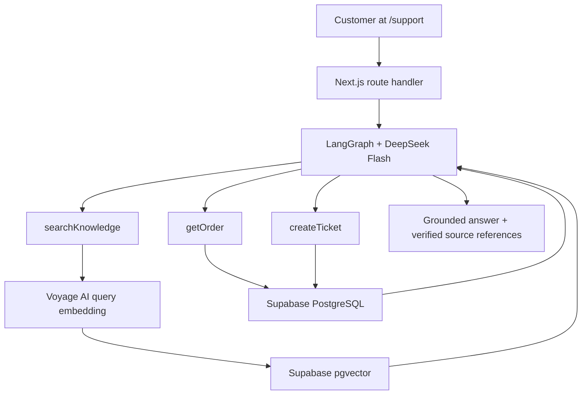

# Resolvo

A focused AI customer-support workspace for a demo business, **Northstar Supply**. Customers get grounded policy answers, order updates, and support tickets through `/support`. The admin workspace manages knowledge, orders, tickets, and conversations.

## Run locally

Requires Node.js **22.16+** and npm. All services live inside one Next.js application.

```powershell
npm ci
Copy-Item .env.example .env.local
# Fill in .env.local, then follow the Supabase setup below.
npm run dev
```

Open [support](http://localhost:3000/support) or [admin](http://localhost:3000/admin).

**Without credentials:** the UI runs with clearly labeled, read-only sample orders and knowledge filenames. Tickets and conversations start empty. Chat returns a setup error; it never substitutes canned answers or a fake RAG implementation. With Supabase configured, all admin data comes from the database, even when it is empty or a provider fails.

## Stack and architecture

- Next.js App Router, strict TypeScript, Tailwind CSS, shadcn/ui primitives, Lucide icons.
- One LangGraph.js support agent with a simple `agent → tools → agent` loop. The model selects tools; there is no keyword-based routing.
- `@langchain/deepseek` with **`deepseek-flash`**, centralized in `lib/ai/model.ts`.
- Voyage AI **`voyage-4-lite`**, used for 1,024-dimensional document and query embeddings through LangChain's `VoyageEmbeddings` integration.
- LangChain text splitting and **SupabaseVectorStore**; Supabase PostgreSQL with pgvector and private Storage.
- Zod validates requests, uploads, metadata, and tool inputs.



### The three tools

| Tool | What it does |
| --- | --- |
| `searchKnowledge({ query })` | Embeds the query and retrieves up to 5 relevant chunks, with document IDs, titles, and content. Scores below 0.35 are discarded. |
| `getOrder({ orderNumber })` | Looks up a real order, including status, tracking, estimated delivery, and delivery date. A missing order is distinct from a database failure. |
| `createTicket({ orderNumber?, customerEmail?, issue })` | Persists a `SUP-…` ticket. Linked orders must first be looked up; their email can supply the contact address. No-order tickets need a customer email. |

Policy questions require retrieval. Return eligibility uses both delivery dates and retrieved return rules. Insufficient evidence produces an explicit unknown answer. Tickets require customer intent and never authorize a refund, return, replacement, or cancellation.

Retrieved content is treated as untrusted evidence. Citation markers are resolved on the server against sources returned in the current turn; unknown IDs cannot produce a citation. Source chips open retrieved excerpts. Raw tool calls, reasoning, embeddings, and graph state are not sent to the customer.

Conversation messages and source excerpts are stored in PostgreSQL. A small `chat_requests` ledger serializes turns, replays completed responses, and allows failed requests to retry. Tickets have a unique request key so a response failure cannot duplicate the same ticket. History is limited to the latest 40 messages per invocation.

### RAG ingestion

Upload PDF, TXT, or Markdown at `/admin/knowledge`:

1. Validate extension, size, and readable text; extract UTF-8 text or parse a text-based PDF using `pdf-parse` v2.
2. Normalize whitespace and split with `RecursiveCharacterTextSplitter` (1,200 characters, 200 overlap).
3. Keep the raw file in the private `support-documents` Storage bucket.
4. Embed chunks using Voyage AI `voyage-4-lite` with `input_type: document` and insert them through LangChain's SupabaseVectorStore. Retrieval uses the same model and dimension with `input_type: query`.
5. Mark the document ready. Retrieval only sees ready documents.

Failed indexing is visible in the admin UI. Delete and re-upload to retry. Deletion removes the raw file and cascades to chunks. Existing conversation excerpts remain historical records. Files are limited to **4 MB** to fit Vercel's request-body limit, and extracted text to 250,000 characters. Scanned or password-protected PDFs require preprocessing; no OCR is included.

## Supabase setup

1. Create a Supabase project.
2. Run [`202610040001_initial.sql`](supabase/migrations/202610040001_initial.sql), then [`202610050001_voyage_embeddings.sql`](supabase/migrations/202610050001_voyage_embeddings.sql), in that order in the SQL editor. Alternatively, link the Supabase CLI and run `supabase db push` to apply both migrations.
3. Run [`supabase/seed.sql`](supabase/seed.sql) in the SQL editor. It inserts five orders and is safe to rerun. Delivery dates are relative to seed time; `ORD-1025` is delivered 12 days earlier.
4. Copy the project URL and **service role** key into `.env.local`.
5. Add DeepSeek and Voyage AI API keys, restart the app, and ingest the sample knowledge.

The migrations create orders, tickets, conversations, messages, documents, chunks, the request ledger, ticket-number sequence, and private Storage bucket. They install pgvector in `extensions`, set the final embedding column to `vector(1024)`, and create an HNSW cosine index. The original migration remains unchanged so already-applied migration history is preserved.

`match_document_chunks(query_embedding, match_count, filter)` returns the shape expected by SupabaseVectorStore. A stored generated `document_id` derives from chunk metadata so LangChain's standard inserts also enforce the document foreign key. `begin_chat_request` and `finish_chat_request` atomically manage chat persistence.

RLS is enabled on all app tables. Browser roles have no table or RPC permissions. The server uses the service role, and no Supabase browser client or anon key is needed.

### Required environment

| Variable | Purpose |
| --- | --- |
| `DEEPSEEK_API_KEY` | DeepSeek Flash chat and tool calling |
| `VOYAGE_API_KEY` | Voyage AI embeddings for ingestion and retrieval |
| `SUPABASE_URL` | Supabase project URL |
| `SUPABASE_SERVICE_ROLE_KEY` | Server-side database and Storage access |

All four are server-only. AI, RAG, and database modules import `server-only`. `.env.local` is ignored by Git. Never prefix secrets with `NEXT_PUBLIC_`.

### Ingest the included knowledge

```powershell
npm run ingest:samples
```

This invokes the real ingestion pipeline for the five Markdown files in `sample-data/`: returns, refunds, shipping, warranty, and FAQ. It calls Voyage AI and stores real embeddings; it skips already-indexed sample titles. You can also upload these files individually through the knowledge page. Database seeding alone does not create embeddings.

### Upgrade an existing workspace

Pause ingestion and chat while applying [`202610050001_voyage_embeddings.sql`](supabase/migrations/202610050001_voyage_embeddings.sql). It removes the old derived vectors, updates the column and similarity-search function to 1,024 dimensions, and marks previously indexed documents as needing re-indexing. Original files, document IDs, orders, tickets, and conversation history are retained. Embeddings from different models cannot be compared or resized into compatible vectors.

Set `VOYAGE_API_KEY` in `.env.local`, restart the app, then run:

```powershell
npm run reindex:knowledge
```

This downloads failed documents from the existing private Storage bucket and rebuilds them through the same Voyage ingestion pipeline. Successful documents are skipped on rerun. If it fails, fix the reported configuration or file issue and rerun. Retrieval only sees documents after their new embeddings are ready.

## Demo scenarios

| Customer message | Expected behavior |
| --- | --- |
| What is your return policy? | Knowledge retrieval, grounded answer, Return Policy citation |
| Where is ORD-1002? | Database lookup, shipped status, tracking `NS-784109235` |
| Can I return ORD-1025? | Order lookup plus retrieval; apply the 30-day window to the delivery date and explain unused/original-packaging conditions |
| My order ORD-1003 arrived damaged. Create a ticket. | Verify the order, persist a ticket, confirm its `SUP-…` number |
| What is your lunar delivery insurance policy? | Retrieve available evidence and say the policy cannot be found; no fabricated policy or citation |

Orders and return eligibility dates age naturally. Reseed into a fresh project when you want a new 12-day delivery example; the seed intentionally preserves existing orders.

## Checks

```powershell
npm run lint
npm run typecheck
npm test
npm run build
npm run start
```

Tests use Node's built-in runner, not a large testing framework. They execute the actual migrations and seed in PGlite PostgreSQL with pgvector; check the existing-workspace upgrade, vector dimensions, metadata, cascading deletion, role permissions, request replay, and ticket uniqueness; verify Voyage document/query requests using a mocked HTTP transport; exercise LangGraph with an explicitly labeled fixture model; and verify citation and input boundaries. These are **local checks**, not proof of live provider behavior.

The production dependency audit (`npm audit --omit=dev`) is clean. The full audit reports five advisories in the development-only Next.js lint dependency chain (`braces` via `micromatch`); there is currently no patched braces release. No lint packages ship with the production application.

After configuring credentials and indexing knowledge:

```powershell
npm run verify:live
```

This calls real DeepSeek, Voyage AI, and Supabase, checks the five scenarios and required tool calls, and deliberately creates **one real demo ticket** in scenario 4. It does not create stored conversations; use the chat to verify conversation persistence and retry behavior. Provider charges apply.

## Deploy to Vercel

Import the repository as a Next.js project, use Node 22, add the four environment variables, and deploy. Apply both migrations and the seed to your Supabase project and run sample ingestion from your local machine. For existing knowledge, run the upgrade and re-index command above. Do not upload `.env.local`. Chat and ingestion use the Node runtime with a 120-second route duration; your Vercel plan must support that duration. Storage and PostgreSQL hold all persistent data.

This deliberately has **no admin authentication or customer order-ownership verification**. Use only synthetic demo data and Vercel deployment protection for portfolio previews. A public business deployment needs admin authentication and verified customer access before connecting real orders or personal information. A conversation UUID acts as a bearer reference, not a verified identity.

## Project areas

- `app/support`, `components/chat`: responsive chat, starter questions, history, retries, source excerpts.
- `app/admin`, `components/admin`: overview, knowledge ingestion/deletion, searchable orders, ticket status changes, conversation reading.
- `app/api`: chat, knowledge, ticket updates, conversation reads.
- `lib/ai`: model, LangGraph, three tools, citation resolution.
- `lib/rag`: extraction, splitting, embeddings, vector store, retrieval.
- `lib/supabase`, `lib/validations`, `types`: server data access, validation, shared types.
- `supabase`, `sample-data`, `scripts`, `tests`: SQL, knowledge samples, ingestion/live verification, local checks.

### Dependency note

The required SupabaseVectorStore still ships through `@langchain/community`, as shown in [Supabase's current integration guide](https://supabase.com/docs/guides/ai/langchain). LangChain has [sunset that package](https://github.com/langchain-ai/langchainjs-community/issues/61); no `@langchain/supabase` successor was available when built. This app uses the current class API, current LangGraph `StateSchema`, and current PDF parser APIs. `.npmrc` disables resolution of unrelated optional integration peers that otherwise pull a conflicting Stagehand/Zod dependency.

LangChain's current Voyage integration is exported from `@langchain/mongodb`; this app uses that package only for embeddings. Vector storage and search remain in Supabase PostgreSQL + pgvector, with no MongoDB service. The direct `@langchain/openai` dependency is removed; DeepSeek's integration still requires it transitively for chat API compatibility. No OpenAI credentials or embedding calls are used.

Model and embedding references: [DeepSeek model names](https://api-docs.deepseek.com/guides/codex), [Voyage models and dimensions](https://docs.voyageai.com/docs/embeddings), [LangChain Voyage integration](https://docs.langchain.com/oss/javascript/integrations/embeddings/voyageai), [LangGraph workflow](https://docs.langchain.com/oss/javascript/langgraph/quickstart).
